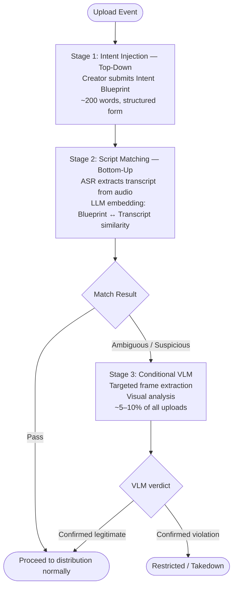

# Reverse Context Anchoring: A Hybrid Pipeline for Low-Cost Video Content Integrity and Intent-Aware Recommendation

Authors: Kiyoung (Independent Research)  
Contact: tjdrldud850@gmail.com  
Status: RFC / Proposal  
Date: 2026-07-03

---

## TL;DR

Video platforms are drowning in re-upload bots — identical clips with swapped narration, uploaded 10–100 times a day. This applies equally to short-form and long-form content. Fixing this with AI video scanning costs a fortune and still misses the point. This proposal adds one step to the upload form: creators declare what their video is about and confirm they have rights to any third-party content they used. Legitimate creators sign in ten seconds. Bad actors face a forced choice — lie and create legal liability, or tell the truth and get filtered. No new AI systems required. No algorithm overhaul. A form field and a legal declaration. Any creator who objects to signing it is, by definition, the problem.

---

## Abstract

Video platforms face a rapidly worsening content quality crisis driven by automated re-upload bots that repurpose existing clips with minimal modifications — swapped narration, altered titles, and superficial edits. This problem affects both short-form and long-form content equally. Current mitigation strategies rely on pixel-level visual language models (VLMs) applied at scale, incurring enormous inference costs while remaining semantically blind to creator intent. We propose Reverse Context Anchoring (RCA): a hybrid content verification architecture that inverts the traditional bottom-up video analysis paradigm. Instead of reading the video first, RCA requires creators to submit a structured Intent Blueprint at upload time, providing the AI system with a semantic ground truth before any visual computation begins. This approach reduces conditional VLM invocation by an estimated 90%+, creates a self-enforcing legal deterrence layer against bad actors, and enables a fundamentally superior Intent-Matching Recommendation Engine that targets viewer cognition rather than behavioral surface patterns.

---

## 1. Problem Definition

### 1.1 The Re-Upload Bot Economy

Modern video platforms (YouTube, TikTok, Instagram) have become systematically exploited by automated pipelines that:

1. Scrape high-performing clips from competitor platforms (X, Reddit, other Shorts channels)
2. Apply minimal transformations: AI-generated narration overlay, title variation, minor cropping
3. Upload at scale (10–100 videos/day per account) to exploit per-view monetization
4. Repeat indefinitely with zero original content creation

From a user perspective, this manifests as identical content served 10–20 times per session under different titles, causing measurable engagement fatigue and platform abandonment.

### 1.2 Why Current AI Solutions Fail

The intuitive solution — deploy a multimodal AI to detect duplicate or low-quality content — runs into a fundamental cost-accuracy tradeoff:

Pixel-level VLM analysis (e.g., Gemini, GPT-4V applied to every uploaded video):
- Requires processing tens of millions of frames daily
- Computes over raw pixel values without semantic context ("reading braille in the dark")
- Can detect visual similarity but cannot determine intent or original authorship
- Infrastructure cost scales linearly with upload volume — economically unsustainable at platform scale

Embedding-based deduplication (video fingerprinting):
- Effective for exact duplicates, defeated by trivial transformations (color grading, crop, speed adjustment)
- No semantic understanding

The core gap: AI can compute what pixels are present, but cannot determine why this video was made or whether the declared purpose matches the actual content.

---

## 2. Proposed Solution: Reverse Context Anchoring (RCA)

### 2.1 Core Principle

RCA inverts the verification direction. Rather than asking "what is this video?" after upload, it asks "what did the creator intend?" before any visual analysis begins.

At upload time, creators submit a structured Intent Blueprint — a short-form declaration of:
- Video concept and purpose
- Target audience
- Original content claim (is this original creation, commentary, reaction, or compilation?)
- Featured persons/entities and their consent status

This blueprint serves as the AI's semantic ground truth — a "teacher's answer key" that transforms expensive visual understanding into cheap text-level verification.

### 2.2 The Three-Stage Verification Pipeline



Legitimate creators who produce original content already have a conceptual plan before filming. Requiring them to articulate it adds zero friction to their existing workflow. Only actors who lack a genuine original concept — i.e., re-upload bots — are structurally disadvantaged by this requirement.

### 2.3 Financial Enforcement Layer

At payout time (monthly monetization settlement), a final validation pass cross-references:
- Declared featured persons against platform identity records
- Claimed content type against verified video metadata
- Blueprint consistency across the creator's content history

The platform does not need to verify every declaration in real-time. The mere existence of a signed legal declaration — attached to every monetized upload — creates a retrospective liability structure. A creator who falsely declares original authorship has, by definition, submitted a fraudulent document. This functions identically to tax self-reporting systems: universal verification is unnecessary because the legal exposure from false declaration is sufficient deterrence.

> "We don't need to catch everyone. We only need to make the risk of getting caught existentially threatening to the economics of the operation."

---

## 3. Deterrence Theory: Friction as Infrastructure

### 3.1 The Economics of Bot Operations

Re-upload bot operators optimize for revenue per unit of effort. Their current cost structure:
- Clip acquisition: near-zero (automated scraping)
- Content transformation: near-zero (AI narration, automated editing)
- Upload: near-zero (API automation)
- Legal risk: near-zero (platform ToS enforcement is slow and inconsistent)

RCA disrupts this by introducing:

1. Mandatory friction: Every upload requires a structured text declaration. Even if this is automated, the automation must now generate semantically coherent, verifiable text that matches the video content — a significantly harder task than simply adding narration.

2. Legal liability escalation: False declarations transform ToS violations into potential fraud liability. The threshold for enforcement shifts from "platform discretion" to "legal exposure."

3. Asymmetric burden: Legitimate creators bear zero marginal cost. Bad actors bear the full compliance burden.

### 3.2 The Self-Selection Filter

The proposal is self-enforcing without universal monitoring.

Bad actors face a forced choice:
- Submit accurate blueprints → reveals re-upload nature → immediate filtering
- Submit false blueprints → creates legal liability → high-risk low-reward
- Don't submit → upload blocked entirely

The system doesn't need to detect bad actors. It makes being a bad actor structurally unprofitable.

### 3.3 The Self-Incrimination Effect

Existing platform enforcement suffers from a persistent legal weakness: proving intent. A bad actor who re-uploads copyrighted content can claim ignorance — "I didn't know this was copyrighted," "I thought it was Fair Use," "I believed the original creator had abandoned the work." Courts and arbitrators are familiar with this defense, and platforms bear the burden of disproving it.

The Intent Blueprint eliminates this defense entirely.

When a creator manually types a video concept, selects content type checkboxes, and declares rights status — they have performed a deliberate cognitive act. The document is authored, timestamped, and cryptographically linked to their account. There is no mechanism by which they can credibly argue they were unaware of what they were submitting.

In legal terms: a false Intent Blueprint is not a Terms of Service violation. It is fraud — a knowing misrepresentation of material fact, made in writing, for financial gain. The distinction matters enormously for enforcement severity, burden of proof, and available remedies.

For the platform, this creates an unambiguous Safe Harbor position. When a rights holder sues, the platform can demonstrate: (1) it required explicit declaration of rights status, (2) the uploader provided that declaration, (3) the declaration was false. Legal and financial liability transfers cleanly to the uploader. The platform is not a passive enabler — it is a defrauded party.

For bad actors, the psychological calculus shifts dramatically. Operating a re-upload bot today carries modest risk: account termination, content removal, occasional DMCA strike. Operating one under RCA means permanently storing self-authored fraud evidence on the platform's servers — evidence that could support criminal prosecution, not just account suspension.

> "They're not just violating terms. They're typing their own confession and submitting it voluntarily."

### 3.4 Framing: Addition, Not Regulation

This proposal adds one step to an existing upload form. It does not restructure the algorithm, introduce new surveillance infrastructure, or change creator monetization terms.

A creator who objects to signing a ten-second declaration is, by definition, a creator who cannot truthfully complete it. The proposal is self-identifying in this regard: legitimate pushback is structurally impossible. Anyone who resists the form reveals, through that resistance, that they have something to hide.

Framed correctly to the creator community: "We're doing a platform cleanup. Honest creators sign in ten seconds and never think about it again. The form exists for everyone else."

---

## 4. Intent-Matching Recommendation Engine

### 4.1 Current Recommendation Failure Mode

Existing recommendation systems operate on behavioral surface matching:
- User watches dashcam accident footage → system infers "likes accident videos"
- Result: feed flooded with accident content, regardless of why the user watched it

The user may have watched for humor, for safety information, for legal interest, or accidentally. The system has no way to distinguish.

### 4.2 Intent-Layer Recommendation

With creator-declared blueprints available at scale, the recommendation system gains access to a semantic layer previously unavailable:

Before (behavioral matching):
```
watched: [dashcam accident compilation]
inferred: user_interest = "accident videos"
recommended: [more accident compilations]
```

After (intent matching):
```
watched: [dashcam compilation | blueprint: "humorous comparison of overconfident 
          driving behaviors to teach beginners through contrast"]
inferred: user_interest = "wit-driven comparative content with educational subtext"
recommended: [satirical legal explainer, comedy sketch about social overconfidence, 
              ironic safety PSA — completely different categories, same cognitive resonance]
```

The recommendation engine shifts from pixel-category matching to conceptual resonance targeting, dramatically reducing the "more of the same" fatigue effect while increasing unexpected discovery — the highest-value engagement signal.

### 4.3 The Cortex-Targeting Effect

When users receive recommendations that match their actual cognitive interest rather than their surface behavioral pattern, the perceived intelligence of the recommendation system increases non-linearly. Users experience the platform as understanding them at a deeper level, producing:

- Increased session duration (content variety without fatigue)
- Increased platform trust and reduced churn
- Higher advertiser value (intent-aligned ads become possible)

### 4.4 AI Consumers and the Integrity of Behavioral Signals

Recommendation systems were designed with the assumption that viewers are human. This assumption is breaking down. AI agents, training data crawlers, summarization services, and automated research tools now constitute a measurable and growing fraction of platform traffic.

When AI systems consume content at scale, engagement metrics (views, watch time, likes) become polluted signals. An AI crawler completing a video generates the same watch-time signal as a human viewer who found it deeply valuable. The platform cannot distinguish them.

Intent Blueprints address this directly: declared creator intent is a human-generated semantic signal that cannot be replicated by behavioral automation. As behavioral metrics degrade in reliability, the blueprint layer becomes increasingly valuable as the only trustworthy signal of content purpose.

---

## 5. Content Rights Declaration Module

### 5.1 The Permission Checkbox as Legal Infrastructure

A critical extension to the Intent Blueprint is a structured Content Rights Declaration — a mandatory checklist that creators complete at upload time regarding any third-party material used in the video.

```
CONTENT RIGHTS DECLARATION (required for all uploads)

Third-Party Content Usage:
☐ This video contains NO third-party clips, images, or audio.
☐ This video contains third-party content licensed under Creative Commons.
   → License type: _______________  Source URL: _______________
☐ This video contains third-party content for which I have obtained 
   explicit written permission.
   → Permission document reference: _______________
   → Rights holder contact: _______________
☐ This video contains third-party content used under Fair Use doctrine.
   → Justification: [commentary / criticism / education / parody]
   → Transformation applied: _______________

Featured Persons:
☐ No identifiable persons appear in this video.
☐ All featured persons have provided written consent.
   → Consent records on file: [Yes / On request]
☐ Featured persons are public figures in their public capacity.

I declare that the above statements are accurate to the best of my knowledge.
Submission of this form constitutes a legally binding declaration.
[SUBMIT & UPLOAD]
```

### 5.2 The Asymmetric Confidence Effect

The psychological and legal power of this module comes from its asymmetric effect on honest versus dishonest creators.

Legitimate creators who obtained proper permissions check the boxes with zero anxiety. The form confirms what they already know: they did it right.

Bad actors who used clips without permission face an impossible choice:
- Check the box anyway → signed false declaration → legal liability
- Leave it unchecked → system flags the upload for restricted distribution
- Abandon the upload entirely → the goal is achieved

The platform does not need to verify every declaration in real-time. The existence of a signed, timestamped legal declaration transforms the enforcement dynamic entirely. What was previously a ToS dispute ("the platform says I violated rules") becomes a fraud case ("the creator signed a false declaration"). This shifts the burden of proof and the severity of consequences dramatically.

Critically, the declaration is self-authored. Unlike a checkbox on a terms-of-service page — which courts often treat as a passive, unread formality — the Intent Blueprint requires active cognitive engagement. The creator must describe their video's purpose in their own words. This authorship destroys the ignorance defense: a person who wrote a detailed description of content they planned to upload cannot later claim they were unaware of what that content was or what rights it involved.

For the platform, this is a complete Safe Harbor instrument. When litigation arrives, the platform's position is unambiguous: "We required explicit written declaration. The uploader provided it. The declaration was false. We are the defrauded party, not the liable one."

### 5.3 Evidence Packaging at Scale

Declarations are stored as immutable, timestamped records linked to the specific video upload event. When a rights holder files a content claim:

1. Platform immediately surfaces the uploader's signed declaration
2. If the declaration falsely claims permission → creator is directly exposed to fraud liability
3. If the declaration accurately disclosed Fair Use → both parties have a documented basis for dispute resolution
4. If the declaration admitted no permission obtained → automatic takedown, no investigation required

This creates a self-documenting legal record for every piece of content on the platform — at zero additional cost to the platform, because creators generate the documentation themselves.

### 5.4 Integration with Financial Enforcement

At monthly payout settlement, the system cross-references:
- Videos that generated revenue
- Their associated Content Rights Declarations
- Any outstanding claims filed against those videos

Revenue from videos with disputed or false declarations is held in escrow pending resolution. This creates a direct financial incentive for accurate declaration: creators who comply get paid on time; those who don't face payment delays and potential clawback.

> "The goal is not to catch every bad actor. It's to make being a bad actor feel dangerous enough that most of them self-select out of the system."

---

## 6. Expected Impact

| Metric | Current State | With RCA |
|--------|--------------|----------|
| VLM inference cost | 100% of uploads | ~5-10% of uploads |
| Re-upload bot viability | High (low friction, low risk) | Low (high friction, legal risk) |
| Recommendation relevance | Surface behavioral | Conceptual/intent-based |
| Original creator revenue share | Diluted by bot traffic | Concentrated on originals |
| Platform legal exposure | Distributed (hard to enforce) | Creator-borne (signed declaration) |

---

## 7. Limitations and Open Questions

1. Blueprint generation automation: Sophisticated bad actors may automate blueprint generation using LLMs. Counter-measure: require blueprints to be submitted before video upload completes, with timestamp locking. Blueprint-video timestamp inconsistency becomes a detection signal.

2. Small creator burden: Creators unfamiliar with structured documentation may find the form intimidating. Mitigation: provide AI-assisted blueprint drafting tools, make the form conversational and low-friction.

3. False positive rate: Legitimate creators who fail to accurately describe their content may be incorrectly flagged. Mitigation: transparent appeal process, human review escalation path.

4. Cross-language generalization: Blueprint-transcript matching must handle multilingual content. This is a solved problem with current multilingual embedding models but requires careful implementation.

5. Jurisdictional variance: Legal liability from false declarations varies by jurisdiction. Platform ToS must be carefully structured to maximize enforceability globally.

---

## 8. Conclusion

Reverse Context Anchoring represents a fundamental inversion of the content moderation paradigm: from expensive, reactive, pixel-level analysis toward cheap, proactive, semantic-level intent verification. By requiring creators to declare intent before upload, RCA simultaneously reduces infrastructure costs, creates self-enforcing legal deterrence, and unlocks a richer semantic layer for recommendation systems.

The proposal requires no breakthrough in AI capability — all components (ASR, text embedding, LLM semantic comparison, conditional VLM) are commercially available today. The innovation is architectural: using the sequence and structure of information flow to eliminate the need for expensive universal visual analysis.

The platform that implements this first gains a structural advantage: cleaner content, lower AI costs, superior recommendations, and a legal framework that places compliance burden on bad actors rather than on the platform itself.

---

## Appendix: Glossary

- Intent Blueprint: Creator-submitted structured declaration of video purpose, concept, and content claims
- Reverse Context Anchoring (RCA): The architectural pattern of providing top-down semantic context before bottom-up signal analysis
- Conditional VLM: Visual Language Model invoked only on flagged content, not universally
- Intent-Matching Recommendation: Recommendation based on declared creator intent rather than viewer behavioral patterns
- Financial Enforcement Layer: Payout-time validation of declarations, creating retrospective legal liability for false claims
- Content Rights Declaration: Mandatory checklist of third-party content usage and featured person consent, submitted at upload time
